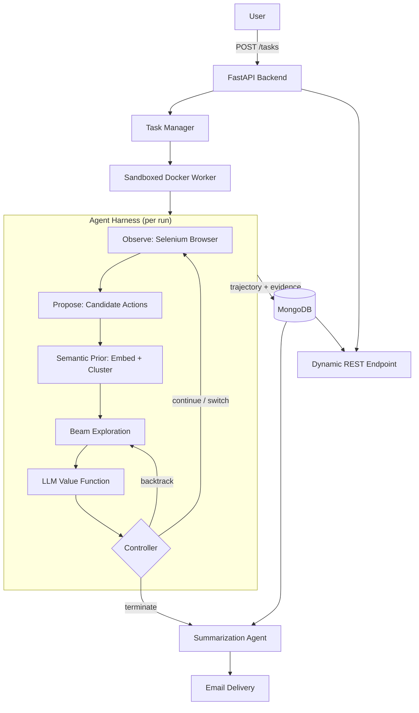

# Promptly

> [!TIP]
> Promptly is an agentic harness that lets users specify **what** they want instead of **how** to navigate a website. It wraps an LLM in a structured agent loop that combines semantic search, value-guided exploration, and sandboxed browser execution to autonomously complete web-based tasks.

Promptly is an agentic harness for long-horizon web tasks. Most web agents today are a single LLM picking the next click in a loop, and they break down on complex, interactive websites. [WebLists](https://arxiv.org/abs/2504.12682) (Bohra et al., 2025) found that state-of-the-art web agents reached only 31% recall on structured extraction tasks, and LLMs with search reached just 3%.

Promptly instead treats every website as its own search space. Given a goal and a starting URL, the harness explores pages, uses the LLM to estimate whether each path is making progress, and decides whether to go deeper, backtrack, or stop. Each run executes asynchronously in an isolated container, and the results are summarized and delivered by an LLM reporting agent.

---

# Table of Contents

- [Motivation](#motivation)
- [Design Principles](#design-principles)
- [System Overview](#system-overview)
- [The Agent Loop](#the-agent-loop)
- [Search Policy](#search-policy)
  - [Semantic Prior](#semantic-prior)
  - [Beam Exploration](#beam-exploration)
  - [LLM Value Function](#llm-value-function)
- [Execution Runtime](#execution-runtime)
- [Architecture](#architecture)
- [Features](#features)
- [Tech Stack](#tech-stack)
- [Getting Started](#getting-started)
- [Usage](#usage)

---

# Motivation

Most browser automation frameworks (Selenium, Playwright, Puppeteer, etc.) assume the developer already knows exactly which pages to visit and which elements to interact with.

LLM agents remove the need for handwritten scripts, but a naive agent loop introduces its own problems:

- The model commits to a single path and rarely recovers from a bad first choice.
- Every page is passed to the LLM, which makes runs slow and expensive.
- There is no explicit budget, so cost and latency are unpredictable.
- The agent has no principled way to decide that the information simply is not there.

Real-world websites make this harder:

- Company websites all have different navigation structures.
- Documentation sites organize information differently.
- Internal dashboards frequently change layouts.
- Useful information is often buried behind multiple navigation layers.

Promptly allows a user to specify **what** they want, and relies on the harness to make the agent reliable enough to figure out **how**.

For example:

> "Find enterprise pricing."

> "Locate the API rate limits."

> "Identify whether this company supports SAML authentication."

The harness determines where to navigate, evaluates which paths appear promising, and continues exploring until enough evidence has been collected to answer the request.

---

# Design Principles

## The harness owns control flow, the model owns judgment

The LLM is not asked an open-ended question like "what should I click next?" It is asked whether the current branch is likely to satisfy the goal. The harness uses that estimate to decide whether to go deeper, backtrack, switch branches, or stop.

## Every website is its own search space

No two websites share the same structure, so Promptly makes no assumptions about layout or navigation. Each run builds its own search tree over the site it is given, where pages are states, links are actions, and the LLM's confidence acts as the value of each state. The same harness works on a site it has never seen before because it searches the site instead of following a script written for it.

## Spend compute where it matters

Expensive LLM calls are reserved for judgment. Breadth is handled by a lightweight embedding model that ranks and clusters candidate actions, so the LLM only ever sees a small, high-value set of options.

## Explicit budgets

Every run has hard limits (`max_depth` and `batch_size`), which keeps cost and latency predictable. This is what makes it practical to run agents as a service instead of as a one-off demo.

## Isolated, durable, inspectable runs

Each task executes in its own container with persisted state. Many agents can run concurrently without interfering with one another, and every trajectory can be inspected after the run finishes.

---

# System Overview

The platform consists of two major subsystems:

1. **The Agent Harness**, which runs a value-guided search over live websites.
2. **The Execution Runtime**, which schedules, isolates, persists, and reports on agent runs.

Together these allow users to submit high-level objectives while the backend independently discovers relevant information and manages long-running agent workloads.

---

# The Agent Loop

Every step of a run follows the same cycle:

```
observe -> propose -> rank -> expand -> evaluate -> decide
   ^                                                  |
   |------------- continue / backtrack <--------------|
                              |
                         terminate -> summarize -> report
```

- **Observe:** Render the page in a real browser and extract its text and candidate links.
- **Propose:** Treat every outgoing link as a candidate action.
- **Rank:** Embed the candidates, cluster them by concept, and score them against the goal.
- **Expand:** Visit the top candidates as a batch.
- **Evaluate:** Ask the LLM how likely each branch is to satisfy the goal.
- **Decide:** Continue deeper, backtrack, switch branches, or terminate.

---

# Search Policy

Instead of blindly crawling every page or letting the model wander, the harness continuously prioritizes where the agent should explore next.

## Semantic Prior

Every page generates a collection of candidate links, and a single page can expose hundreds of them.

Rather than passing all of them to the LLM, Promptly embeds each candidate into semantic vector space using Sentence Transformers. This gives the harness a cheap, goal-conditioned prior over which actions are worth considering.

The embeddings also allow links discussing similar concepts to be clustered together before traversal.

For example, links such as:

- Pricing
- Enterprise
- Plans
- Business

naturally cluster together even if their URLs share little lexical similarity.

This significantly reduces redundant exploration, keeps the LLM's context small, and improves the likelihood of discovering relevant content early.

---

## Beam Exploration

Traditional crawlers and simple agents typically perform either:

- Breadth-first search
- Depth-first search
- Greedy single-path traversal

Promptly instead runs a beam search, evaluating multiple promising paths simultaneously.

Each exploration step selects a batch of high-confidence candidates, which keeps several hypotheses alive at once without fully expanding the search tree. One misleading link is no longer enough to derail the whole run.

This approach balances:

- Search breadth
- Computational cost
- Exploration speed

while avoiding early commitment to a single potentially incorrect path.

---

## LLM Value Function

After each exploration batch, an LLM evaluates the collected evidence against the original objective.

Instead of simply asking:

> "What page should I visit next?"

the model acts as a value function, estimating whether the current branch appears likely to satisfy the user's goal.

Based on this confidence score, the harness decides to:

- Continue deeper
- Backtrack
- Prioritize an alternate branch
- Terminate exploration

Termination covers two cases. Either enough evidence has been collected to answer the request, or the search space has been exhausted and the harness concludes that the information does not exist. Being able to say "this isn't here" instead of hallucinating an answer or looping until the budget runs out is a core part of what makes the agent reliable.

This produces adaptive, goal-directed navigation rather than deterministic crawling.

---

# Execution Runtime

The agent harness is only one part of the platform.

Promptly also provides a runtime built for long-running, concurrent agent workloads.

When a task is submitted:

1. A unique task identifier is created.
2. A REST endpoint is generated for the task.
3. The agent run is scheduled asynchronously.
4. The agent executes inside an isolated Docker container with its own browser session.
5. Trajectory state and intermediate results are persisted throughout execution.
6. Results become available through the task endpoint.
7. A summarization agent condenses the trajectory into a grounded report and delivers it via email.

Because every run is sandboxed and stateful, multiple agents can run concurrently without interfering with one another, failures stay contained, and every run leaves an inspectable record.

---

# Architecture



---

# Features

## Agent Harness

- Structured observe, propose, rank, expand, evaluate, decide loop
- Semantic prior over candidate actions
- Beam search across multiple navigation paths
- LLM value function for branch evaluation
- Automatic backtracking when confidence decreases
- Explicit termination when the answer is found or does not exist
- Hard compute budgets per run

## Execution Runtime

- Dynamic REST endpoint generation
- Asynchronous agent execution
- Sandboxed, containerized browser sessions
- Concurrent run isolation
- Persistent trajectory and task tracking

## Agentic Reporting

- Automatic result summarization
- Email delivery of completed runs
- Structured execution metadata
- Persistent task history

---

# Tech Stack

## Backend

- FastAPI
- Python
- Uvicorn

## AI

- Groq
- Google Gemma
- Sentence Transformers
- scikit-learn

## Browser Automation

- Selenium
- BeautifulSoup

## Infrastructure

- Docker
- Docker Compose
- MongoDB
- PyMongo

## Utilities

- Arcade.dev
- Requests
- Pydantic Settings
- python-dotenv
- Pytest

---

# Getting Started

## Running with Docker Compose

Build and start all services:

```bash
docker compose up --build
```

Run in detached mode:

```bash
docker compose up --build -d
```

View logs:

```bash
docker compose logs -f
```

Stop all services:

```bash
docker compose down
```

Once running, the API will be available at:

```text
http://localhost:8000
```

> [!NOTE]
> Adjust the port if your `docker-compose.yml` exposes a different one.

---

# Usage

## 1. Launch an Agent Run

Each task dynamically provisions its own endpoint.

Example:

```bash
curl -X POST http://localhost:8000/tasks \
  -H "Content-Type: application/json" \
  -d '{
        "goal": "Find pricing information for enterprise plans",
        "start_url": "https://example.com",
        "email_to": "you@example.com",
        "max_depth": 5,
        "batch_size": 10
      }'
```

- `goal`: the natural-language objective the value function scores against
- `start_url`: the root of the search
- `max_depth`: the maximum trajectory length
- `batch_size`: the beam width, or number of candidates expanded per step
- `email_to`: where the final report is delivered

Example response:

```json
{
  "task_id": "abc123",
  "endpoint": "/tasks/abc123",
  "status": "queued"
}
```

---

## 2. Check Run Status

Monitor progress through the generated task endpoint:

```bash
curl http://localhost:8000/tasks/abc123
```

---

## 3. Receive Results

Once the harness terminates the run:

- The trajectory and collected evidence are stored.
- A summarization agent writes a grounded report.
- The report is automatically delivered via email.
- Results remain accessible through the task endpoint.
