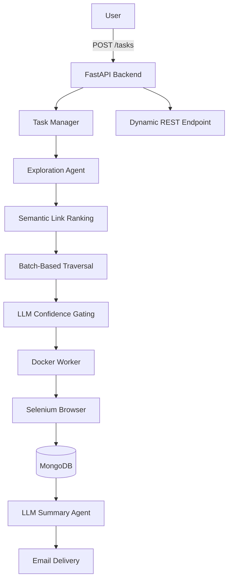

# Promptly

> [!TIP]
> Promptly lets users specify **what** they want instead of **how** to navigate a website. It combines semantic search, multi-agent exploration, LLM reasoning, and containerized browser automation to autonomously complete web-based tasks.

Promptly is an agentic web automation platform that transforms high-level goals into autonomous browser workflows.

Traditional web automation tools rely on handcrafted scripts that only work for websites they were explicitly written for. Promptly instead approaches automation as a search problem: given a goal and a starting website, it incrementally explores pages, evaluates whether it is making meaningful progress, and adapts its strategy until it either satisfies the objective or determines that no relevant information exists.

To support long-running automation tasks, Promptly also provides a backend execution platform that dynamically provisions REST endpoints for submitted jobs, executes each workflow asynchronously inside an isolated container, and automatically summarizes results through an LLM-powered email agent.

The project explores the intersection of semantic search, multi-agent reasoning, browser automation, and distributed task execution to build a more flexible alternative to traditional rule-based web automation.

---

## Table of Contents

- [Motivation](#motivation)
- [System Overview](#system-overview)
- [Goal-Directed Website Exploration](#goal-directed-website-exploration)
  - [Semantic Candidate Ranking](#semantic-candidate-ranking)
  - [Batch-Based Exploration](#batch-based-exploration)
  - [LLM Confidence Gating](#llm-confidence-gating)
- [Dynamic Task Execution](#dynamic-task-execution)
- [Architecture](#architecture)
- [Features](#features)
- [Tech Stack](#tech-stack)
- [Example Workflow](#example-workflow)
- [Why Promptly?](#why-promptly)

---

# Motivation

Most browser automation frameworks (Selenium, Playwright, Puppeteer, etc.) assume the developer already knows exactly which pages to visit and which elements to interact with.

That assumption breaks down for many real-world tasks:

- Company websites all have different navigation structures.
- Documentation sites organize information differently.
- Internal dashboards frequently change layouts.
- Useful information is often buried behind multiple navigation layers.

Rather than scripting every interaction manually, Promptly allows a user to specify **what** they want instead of **how** to obtain it.

For example:

> "Find enterprise pricing."

or

> "Locate the API rate limits."

or

> "Identify whether this company supports SAML authentication."

Promptly autonomously determines where to navigate, evaluates which paths appear promising, and continues exploring until enough evidence has been collected to answer the request.

---

# System Overview

The platform consists of two major subsystems:

1. **Goal-Directed Website Exploration**
2. **Dynamic Task Execution**

Together these allow users to submit high-level objectives while the backend independently discovers relevant information and executes long-running workflows.

---

# Goal-Directed Website Exploration

Instead of blindly crawling every page, Promptly continuously prioritizes where it should explore next.

## Semantic Candidate Ranking

Every page generates a collection of candidate links.

Rather than evaluating these individually, Promptly embeds each candidate into semantic vector space using Sentence Transformers.

The embeddings allow links discussing similar concepts to be clustered together before traversal.

For example, links such as

- Pricing
- Enterprise
- Plans
- Business

naturally cluster together even if their URLs share little lexical similarity.

This significantly reduces redundant exploration while improving the likelihood of discovering relevant content early.

---

## Batch-Based Exploration

Traditional crawlers typically perform either:

- Breadth-first search
- Depth-first search
- Greedy single-path traversal

Promptly instead evaluates multiple promising paths simultaneously.

Each exploration step selects a batch of high-confidence candidates, allowing the system to diversify exploration without fully expanding the search tree.

This approach balances:

- search breadth
- computational cost
- exploration speed

while avoiding early commitment to a single potentially incorrect path.

---

## LLM Confidence Gating

After each exploration batch, an LLM evaluates the collected context against the original objective.

Instead of simply asking

> "What page should I visit next?"

the model estimates whether the current branch appears likely to satisfy the user's goal.

Based on this confidence score the system decides to

- continue deeper,
- backtrack,
- terminate exploration,
- or prioritize an alternate branch.

This produces adaptive navigation rather than deterministic crawling.

---

# Dynamic Task Execution

Website exploration is only one part of the platform.

Promptly also acts as an execution backend for autonomous browser workflows.

When a task is submitted:

1. A unique task identifier is created.
2. A REST endpoint is generated for the task.
3. Execution begins asynchronously.
4. Browser automation runs inside an isolated Docker container.
5. Progress is persisted throughout execution.
6. Results become available through the task endpoint.
7. An LLM summarizes findings and delivers them via email.

Because every workflow executes independently, multiple automation jobs can run concurrently without interfering with one another.

---

# Architecture

---

# Features

### Intelligent Website Navigation

- Semantic ranking of discovered links
- Batch-based exploration across multiple navigation paths
- Adaptive traversal using LLM confidence evaluation
- Automatic backtracking when exploration confidence decreases

### Autonomous Workflow Execution

- Dynamic REST endpoint generation
- Asynchronous task execution
- Containerized browser sessions
- Concurrent workflow isolation
- Persistent task tracking

### Agentic Reporting

- Automatic result summarization
- Email delivery of completed workflows
- Structured execution metadata
- Persistent task history

---

# Tech Stack

## Backend

- FastAPI
- Python
- Uvicorn

## AI

- Groq
- Google Gemma
- Sentence Transformers
- scikit-learn

## Browser Automation

- Selenium
- BeautifulSoup

## Infrastructure

- Docker
- Docker Compose
- MongoDB
- PyMongo

## Utilities

- Arcade.dev
- Requests
- Pydantic Settings
- python-dotenv
- Pytest

---

# Example Workflow

A user submits

> "Find the enterprise pricing page for Example.com."

The system then

1. Creates a new task.
2. Begins exploring from the provided URL.
3. Embeds and clusters discovered links.
4. Selects the most promising navigation branches.
5. Uses an LLM to determine whether progress is being made.
6. Continues exploration until pricing information is found.
7. Stores the results.
8. Sends a summarized report via email.

---

# Why Promptly?

Most automation platforms require developers to encode every interaction manually.

Promptly instead separates **intent** from **execution**.

Rather than specifying every click, the user specifies the desired outcome while the platform determines how to reach it through semantic reasoning, adaptive exploration, and autonomous execution.

The result is a backend capable of operating across unfamiliar websites with significantly less task-specific engineering than traditional rule-based automation systems.